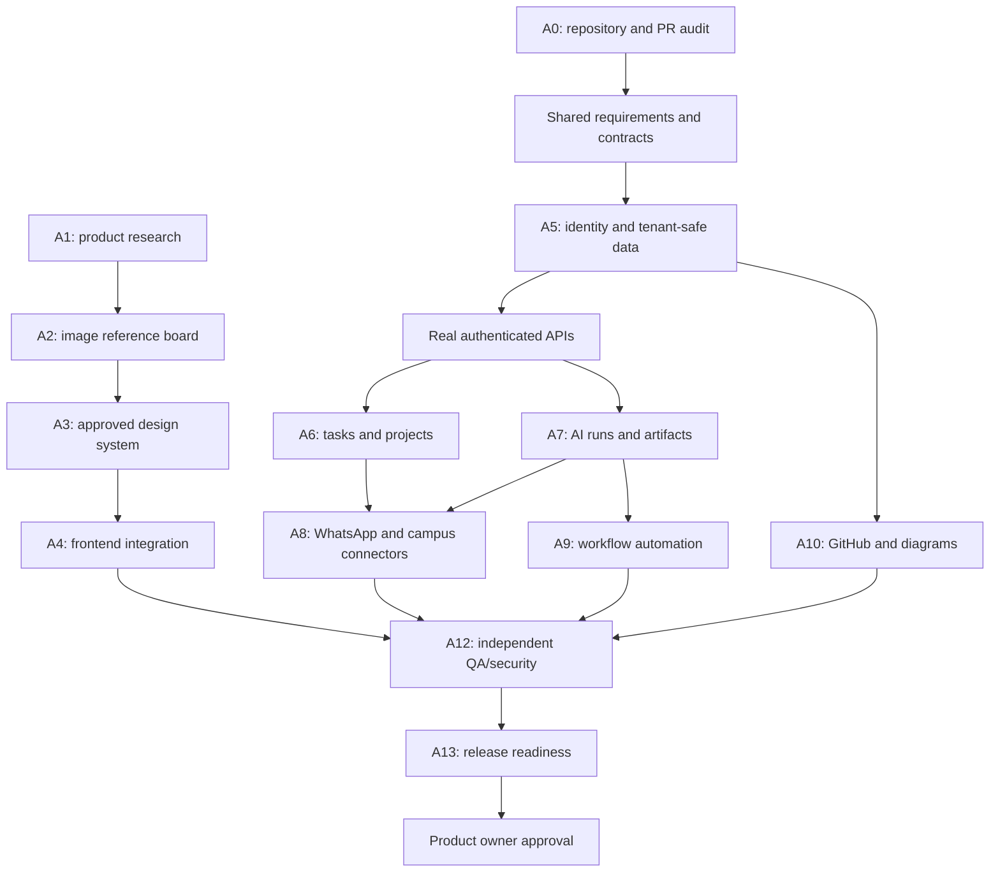

# 03 — Dependency Map & Parallelization

## Dependency chain

1. Audit current repository, open PRs, CI and production claims.
2. Confirm requirements, personas, roles, API/data/status/error contracts and threat boundaries.
3. Research visual references; obtain owner approval for representative UI pages.
4. Build identity/session/workspace and tenant-safe persistence.
5. Connect frontend shell to real APIs; build one task flow.
6. Prove AI run → review/approval → saved artifact end-to-end.
7. Complete WhatsApp gateway, then one authorized campus connector.
8. Build typed workflow versioning and safe worker execution.
9. Add GitHub and diagram tooling incrementally.
10. Add usage/plan/billing after metering requirements are frozen.
11. Harden security, recovery, accessibility and release operations.

## Safe parallelism matrix

| Work pair | Parallel? | Condition |
|---|---|---|
| Product requirement research + repository audit | Yes | Shared scope and known open questions are recorded |
| Product research + visual reference research | Yes, sequential handoff is also fine | A1 user-flow brief informs A2's page boards |
| UI implementation + backend API | Yes after G2 | Frozen schema, auth scope and named file owners |
| Auth/data migration + task CRUD | Limited | A5 owns migrations; A6 uses agreed schema |
| AI runtime + frontend AI screen | Yes after contract | Same run-state/error/API contract |
| WhatsApp adapter + task/run service | Yes after contract | Normalized event and queue semantics are frozen |
| Workflow canvas + workflow API | Yes after schema | Typed node/edge, validation and lifecycle contract is frozen |
| GitHub integration + ERD editor | Yes with separate paths | Same tenant/storage contracts; no shared-file overlap |
| Shared auth/schema/migration/tokens/app shell | No by default | One owner or an explicitly coordinated change window |
| Implementation + final independent QA | Sequential for final gate | A12 reviews actual final diff and evidence |

## Dependency graph

A0 sets scope and coordinates. A1 establishes user requirements; A2 translates approved requirements into screenshot-based visual research; A3 locks shared design rules. A5 owns identity/tenant foundations. A4 integrates the frontend only against agreed contracts. A6/A7 deliver tasks, AI runs and artifacts; A8 integrates external channels; A9/A10 deliver automation and Developer Studio; A12 independently gates changes; A13 prepares release when justified.

## Merge and contract-change rules

- Every agent branches from an agreed base and opens a PR; no ordinary direct commits to main.
- No simultaneous edits to the same migration, OpenAPI schema, shared types, design tokens, app-shell navigation or root agent instructions.
- A contract change requires a recorded change proposal, compatibility/migration plan, affected ticket list and notification to every consumer.
- A0 verifies dependencies and path conflicts; A12 checks the actual final diff and CI on the latest PR head.
- Unresolved blockers stop integration. Do not merge incompatible partial implementations to show activity.
