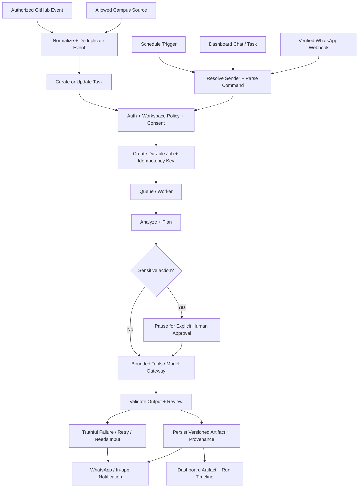

## 6. Shared domain flow (all entry points converge on one engine)

### Common task/run status vocabulary

Use a single documented state machine, for example:
- `queued`: durable job accepted, not started.
- `running`: worker execution in progress.
- `needs_input`: explicit information missing; no false success.
- `waiting_approval`: action paused until an authorized actor decides.
- `ready_for_review`: draft/output created but awaits user review.
- `completed`: actual work completed and required validations passed.
- `failed`: execution ended with a failure; show safe reason + request/run ID.
- `cancelled`: cancellation actually took effect; if it could not, state that clearly.
- `retrying`: safe retry in progress after retry policy admitted it.

A page must not invent its own alternative labels. Map every API state to the shared UI state definition.

---

## 7. API, data, security, and reliability contracts

### API rules

- Version API routes (`/v1/...`); use Pydantic schemas, reject unknown/unexpected fields for sensitive inputs, bound payload sizes and lists.
- Derive actor/user/workspace from authenticated session, never from an untrusted body alone.
- Standard errors: stable `code`, human-readable safe message, `request_id`, field errors where applicable. Never expose stack trace or secret.
- Use pagination and explicit filters on list endpoints; order deterministically.
- Use idempotency keys for retries/webhook events and job creation. External source IDs must be namespaced by integration/workspace.
- Long AI/automation jobs return a run/job ID and status, not a request that waits for minutes.
- API docs are source of truth. Update contract test/typed client whenever response fields change.

### Tenant/security rules

- RBAC must be enforced on server, data access, worker jobs, artifact URLs, webhook handlers, events streams, and connector calls.
- Test IDOR/BOLA: user A cannot access user B resource by replacing UUID/ID in URL/body/query.
- Encrypt integration credentials at rest; secrets never return in response. Revoke/rotate connections; limit provider scopes.
- Validate webhook signatures against raw request body. Check timestamps/replay, dedupe message IDs and rate-limit per connector/tenant.
- Restrict browser/filesystem/shell/Python capabilities using existing runtime boundary. Never allow prompt/model to self-assign tools.
- Define retention/deletion/backup and privacy handling for course work and personal data.
- Treat external course material, file content and issue comments as **untrusted input**, not instructions that can override system rules.
- Use audit records for role changes, connector consent/revoke, approvals, workflow publish, billing and privileged support action.

### Data ownership rules

Each project/task/run/workflow/artifact/integration/event is tied to an owner and normally a `workspace_id`. Apply foreign keys, tenant-compatible uniqueness and indexes. Do not attach an artifact to a new owner by changing only the UI. Credentials and binary file contents do not belong in ordinary logs/database text fields.

### Model/provider rules

Use the existing `ModelGateway` abstraction. Each provider adapter needs tests, bounded request/response size, timeout, usage accounting where available, secret redaction, failure translation, model allowlist/config and provider terms review. “Free API” does not mean unlimited or stable; design quotas and graceful fallback. Never silently use another provider if the user selected local/private processing.

### Integrations rules

A connector contract should include `connect`, `validate_credentials`, `sync`, `normalize_event`, `health`, `revoke`, `scopes`, rate limit behavior and a typed failure model. For campus integration, select one authorized pilot platform first. Do not write a brittle scraper for an unknown LMS as if it were a generic solution.

### Billing rules

Meter the actual billable action server-side; each usage event needs unique id, user/workspace, feature, provider/model if applicable, quantity, timestamp and source run. Webhook handlers must verify signatures and be idempotent. Frontend entitlement checks improve UX; backend entitlement checks enforce limits.

---

## 8. Engineering standards

### Branch / PR / commit

- One ticket or a tightly coupled vertical slice per branch.
- Branch naming: `feat/UTA-123-task-inbox`, `fix/UTA-124-whatsapp-dedupe`, `docs/UTA-125-design-decisions`.
- Small, named commits, e.g. `feat(tasks): add workspace-scoped task list`.
- Never push directly to `main` as the normal workflow; do not force-push shared branches.
- PR body includes: context, scope, files changed, screenshots, API/database changes, security review, tests actually run with results, migrations/rollback, known limitations.
- A reviewer must view the final PR diff and ensure CI ran on the latest PR HEAD.

### Change management

- Read file(s) and callers before edits.
- No blanket rewrites, file deletions, schema changes or dependency churn without a reason.
- Keep existing tests and add regression coverage for the bug/feature.
- Prefer existing project dependency and abstractions. Before adding a library, compare maintenance, license, version compatibility, security notices and the actual need.
- Do not introduce a monorepo/build-tool change casually. Get A0 approval and document trade-offs.
- Include migrations/backfill plan where data shape changes. Test fresh install and upgrade path.

### Definition of Done (DoD)

A ticket is DONE only when every applicable item is verified:
- [ ] Acceptance criteria checked against a real running implementation.
- [ ] Role/permission and tenant scope enforced server-side.
- [ ] Loading, empty, success, validation, error, offline/timeout, disabled, and retry states handled where relevant.
- [ ] Automated tests cover happy path plus regression and major edge cases.
- [ ] Formatting, lint, type check, build, API/contract/integration tests pass.
- [ ] Responsive and keyboard usability inspected for UI work.
- [ ] No fake metrics, inert actions, placeholder secrets, or unlabelled mocks.
- [ ] Documentation, API schema, migration/rollback and environment configuration updated.
- [ ] Security/privacy implications reviewed; secrets/redaction verified.
- [ ] Evidence attached to PR and independent review done.
- [ ] Roadmap/feature status updated only after proof.

Not-run tests are reported as NOT RUN; a failed environment isn't evidence of passing.

---

## 9. Prompt system
