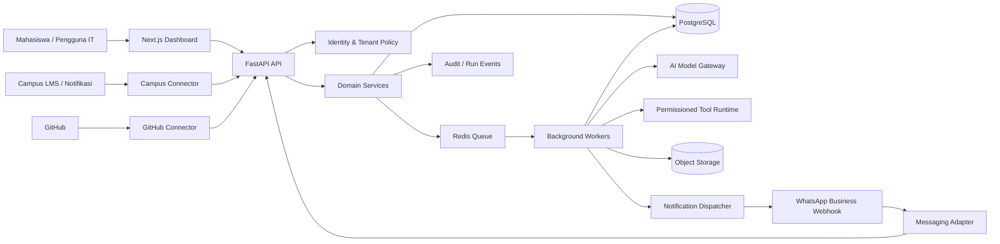

# Product & Engineering Blueprint — Product, Workflows, and Architecture

**Tanggal audit:** 16 Oktober 2026  
**Repository:** [Fbi-Boy/universal-task-ai](https://github.com/Fbi-Boy/universal-task-ai)  
**Branch yang diaudit:** main  
**Frontend proposal:** [PR #173 — Premium command center and visual workflow builder](https://github.com/Fbi-Boy/universal-task-ai/pull/173)

> Dokumen ini adalah rancangan kerja berdasarkan source code dan metadata repo yang diperiksa. Ini bukan klaim bahwa semua fitur sudah dibuat atau dites. Jangan menimpa kode pengguna atau menganggap PR draft sudah menjadi bagian dari main.

## 1. Ringkasan eksekutif

Universal Task AI sebaiknya dikembangkan sebagai **student productivity workspace untuk pengguna IT**, bukan sekadar chatbot dan bukan sekadar tiruan ClickUp/n8n. Satu akun memiliki proyek, task, chat AI, file hasil kerja, integrasi kampus, automation, dan developer tools. WhatsApp menjadi kanal notifikasi serta command, sementara dashboard menjadi tempat utama untuk melihat konteks, memeriksa hasil, dan mengontrol akses.

### Kondisi nyata repo saat audit

| Area | Yang ditemukan di repo | Kesimpulan |
|---|---|---|
| Core AI | Task intake/analyzer, planner, task service/executor, model gateway, tool registry/boundary | Pertahankan; integrasikan melalui kontrak yang jelas. |
| Model provider | Gateway OpenAI dan Ollama sudah ada; dukungan model diatur server-side | Buat interface provider yang bisa diperluas; jangan hardcode satu model. |
| Eksekusi aman | Permission checks, approval, audit, pembatasan tool, sandbox dan security tests tersedia | Jadikan fondasi keamanan semua modul baru. |
| API | FastAPI, endpoint task/analyze, tools, run history, approvals, events, settings | Fondasi API ada; domain produk multiuser belum lengkap. |
| Data | SQLite untuk run state/approval/audit; pengaturan saat ini disimpan in-memory | Belum cukup untuk akun SaaS multi-tenant di produksi. |
| UI di main | `backend/web/index.html`, `ui.css`, `ui.js` | Workspace single-page, belum mencakup semua area produk. |
| UI baru | PR #173 menambahkan aplikasi Next.js/TypeScript dan visual workflow draft | Draft; metrik/aktivitas bersifat contoh dan belum tersambung ke backend. |
| WhatsApp | Ada sejumlah class keamanan, webhook, inbound/outbound dan provider | Adapter inbound masih memiliki `NotImplementedError`; belum menjadi alur end-to-end. |
| Scheduler | Ada schedule store/worker/pipeline | Primitive tersedia, tetapi bukan produk automation lengkap dengan builder, koneksi, approval, dan observabilitas. |
| ERD/diagram | Ada validator ERD dan flowchart sederhana | Validator bukan editor visual atau generator diagram lengkap. |
| Akun/tenant | API key global; `/v1/settings` menggunakan `DEFAULT_USER`; settings store in-memory | Wajib diperbaiki sebelum membuka akses beberapa pengguna. |
| Integrasi kampus, GitHub, backlog, billing | Belum tampak sebagai sistem produk end-to-end di main | Perlu dibangun sebagai domain dan integration adapter baru. |
| Deployment | Docker/workflows/release checks tersedia | Roadmap repo sendiri menyatakan deployment produksi nyata belum diverifikasi. |

### Temuan review PR #173

- PR berstatus **open dan draft**, dengan 9 file berubah pada saat diperiksa. Jangan sebut fitur itu sudah masuk main.
- Scope-nya adalah dashboard Next.js, command center, AI workspace UI, dan workflow canvas sederhana.
- Deskripsi PR menyatakan task submission, penyimpanan workflow, drag-and-drop, dan real execution belum terhubung ke backend. Metrik dan aktivitas masih ilustratif.
- `frontend/app/globals.css` pada branch PR memiliki custom property `--shadow` yang tampak tidak valid karena pemanggilan `rgba(...)` tidak ditutup dengan `)`. Perbaiki sebelum review visual.
- CI frontend pada PR mengatur lint dan production build. Browser smoke tests belum ada menurut checklist PR.

**Keputusan audit:** gunakan core Python yang ada, review dan rapikan PR dashboard, lalu tambah data model multi-tenant dan integrasi nyata. Jangan mengganti seluruh backend atau menggabungkan PR hanya karena tampilan sudah terlihat modern.

## 2. Definisi produk

### Visi

Satu workspace yang membantu mahasiswa mengelola pekerjaan kuliah dan proyek IT: mendeteksi tugas baru dari sumber yang diizinkan, memberi notifikasi, membantu memahami dan mengerjakan draft, menyimpan hasil sebagai artefak, serta menyediakan board, dokumentasi, diagram, repository dan automation.

### Prinsip produk

1. **Satu sumber data untuk setiap akun.** Task, file, workflow, chat, koneksi dan log harus punya owner/workspace yang jelas.
2. **AI bekerja di dalam batas izin.** Jawaban model tidak boleh memberikan permission baru pada dirinya sendiri.
3. **Tidak ada status palsu.** UI hanya menampilkan data backend yang nyata. Data contoh harus diberi label Demo.
4. **Human review untuk dampak penting.** Membuat draft dan menyiapkan file bisa diotomasi; submission resmi atau tindakan yang menyatakan mahasiswa hadir harus tetap membutuhkan tindakan nyata dan persetujuan eksplisit pemilik akun.
5. **Satu modul satu tanggung jawab.** Integrasi kampus, WhatsApp, model provider, billing, dan workflow engine berkomunikasi lewat interface; jangan menanam logika seluruh produk di satu controller.
6. **Build modular monolith dulu.** Belum perlu memecah semua domain menjadi microservices. Pisahkan module/service/worker di satu codebase sampai ada kebutuhan skala yang terbukti.

### Navigasi utama yang disarankan

1. **Overview** — tenggat terdekat, tugas yang belum selesai, run terakhir, integrasi terputus, status sistem.
2. **AI Workspace** — chat dengan AI, prompt task, rencana kerja, status eksekusi, hasil dan riwayat konteks.
3. **My Tasks** — Inbox, Today, Upcoming, All Tasks; list, kanban, kalender, prioritas, label, subtasks, checklist, dependency.
4. **Projects & Backlog** — project overview, board/list, backlog, sprint, milestone, dokumen dan anggota.
5. **Campus Hub** — kursus, assignment, deadline, kalender, reminder presensi dan konektor kampus.
6. **Automations** — workflow builder, trigger, action, conditions, variables, run history, retries, approvals dan templates.
7. **Developer Studio** — GitHub, ERD, DFD, flowchart, sequence diagram, UML/class diagram, API design dan export.
8. **Artifacts / Files** — file hasil AI, versi, preview, download, referensi sumber dan project terkait.
9. **Integrations** — WhatsApp, campus LMS, GitHub, email/calendar, model provider, storage.
10. **Usage & Plan** — penggunaan token, task, workflow, storage dan limit paket.
11. **Settings & Security** — profil, workspace, session, timezone, koneksi, privacy, consent dan audit.

Jangan menampilkan seluruh menu sebagai halaman aktif jika belum diimplementasikan. Untuk modul yang belum tersedia, tampilkan status Coming soon yang jujur atau jangan tampilkan sama sekali.

## 3. Alur bisnis end-to-end

### A. Deteksi tugas kampus → WhatsApp → AI → artefak tersimpan

1. **Connect source.** Pengguna memilih koneksi kampus yang didukung dan memberi consent. Prioritasnya API resmi/authorized integration; alternatifnya email notifikasi yang diizinkan atau browser companion read-only yang dijalankan di sesi pengguna.
2. **Sync event.** Connector mengambil perubahan sejak checkpoint terakhir. Validasi tenant, akun, sumber dan ukuran payload.
3. **Normalize + deduplicate.** Ubah event ke format standar `CampusEvent`. Simpan unique key berdasarkan workspace, provider dan external ID supaya polling/webhook tidak menciptakan tugas duplikat.
4. **Create task.** Assignment baru menjadi record kampus serta item di My Tasks; simpan kelas, tanggal, deadline, link sumber, instruksi yang tersedia, dan waktu deteksi.
5. **Notify.** Kirim ringkasan pendek melalui WhatsApp: kelas, judul, deadline, dan tautan aman ke dashboard. Hindari mengirim dokumen sensitif penuh lewat chat.
6. **Reply command.** Contoh: `KERJAKAN UTA-1042` atau `DETAIL UTA-1042`. `KERJAKAN` tanpa ID hanya diterima jika ada satu tugas yang jelas; selain itu bot harus meminta klarifikasi.
7. **Authorize command.** Verifikasi signature webhook provider, nomor pengirim yang telah ditautkan ke akun, opt-in, command, rate limit, dan idempotency key. Jangan percaya hanya pada isi teks WhatsApp.
8. **Create run.** Masukkan job ke worker queue; balas bahwa job diterima beserta ID dan statusnya. Jangan menahan webhook saat AI sedang bekerja.
9. **Plan + generate.** Task analyzer mengekstrak deliverable, batasan, rubrik/instruksi, konteks yang disetujui pengguna, dan hal yang masih harus ditanyakan. Model dipilih melalui provider gateway dan usage budget.
10. **Review + validate.** Periksa kelengkapan format, kutipan/sumber bila diperlukan, file output, serta kegagalan provider. Tampilkan status `needs_input`, `waiting_approval`, `ready_for_review`, `failed`, atau `completed` secara akurat.
11. **Persist artifact.** Simpan metadata di database dan file di object storage dengan owner/workspace yang jelas. Versi hasil dan jejak sumber tidak hilang ketika halaman ditutup.
12. **Deliver.** Kirim notifikasi WhatsApp dengan link bertanda tangan dan masa berlaku terbatas ke dashboard/unduhan. Pengguna bisa membuka hasil, meminta revisi, menyalin, mengunduh, dan memutuskan langkah berikutnya.
13. **Audit.** Simpan event, biaya/usage model, waktu mulai-selesai, versi prompt/workflow, status, error code yang aman, dan actor untuk persetujuan.

**Batas integritas akademik:** produk boleh membantu menjelaskan materi, merencanakan, membuat draft, membantu kode, menjalankan test, menyusun laporan dan menyimpan artefak. Jangan mengotomasi tindakan untuk berpura-pura menjadi mahasiswa, memalsukan kehadiran, melewati verifikasi kehadiran, atau melakukan submission resmi secara diam-diam. Tampilkan hasil sebagai draft untuk ditinjau. Setiap integrasi resmi yang mungkin melakukan submission wajib memiliki dukungan platform, aturan penggunaan yang jelas, dan konfirmasi eksplisit tepat sebelum tindakan itu.

### B. Presensi dan jadwal

- Sinkronkan jadwal kelas dan, jika sumbernya mendukung, status/tautan presensi.
- Kirim reminder sebelum jadwal dimulai, buka tautan resmi, dan beri checklist `Saya sudah hadir` yang hanya memperbarui task/reminder di Universal Task AI.
- Jangan klik check-in, memalsukan lokasi, memutar ulang token, meniru wajah/perangkat, atau menyatakan hadir tanpa tindakan nyata dari mahasiswa.
- Simpan hanya data yang diperlukan; jangan mengekstrak password kampus atau mengambil kredensial dari browser secara diam-diam.

### C. Automation generik ala n8n

`Trigger → Validate event → Deduplicate → Conditions → Plan → Permission check → Execute step → Validate output → Optional approval → Persist result → Notify`

Contoh trigger yang dapat didukung bertahap: jadwal, tugas baru, WhatsApp command, GitHub issue/PR, webhook milik pengguna, atau event internal. Contoh action: membuat task, menyusun draft, merangkum dokumen, membuat artefak, mengirim notifikasi, atau membuka approval.

Setiap execution harus memiliki status, timeout, retry policy, cancellation policy, run log, input/output teredaksi, versi workflow, dan idempotency key. Workflow tidak boleh menjalankan tool yang tidak diizinkan oleh workspace/pemiliknya.

## 4. Arsitektur target

### Komponen

- **Frontend:** Next.js + TypeScript dari jalur PR #173 setelah lint, build, aksesibilitas dan smoke tests lolos.
- **API:** FastAPI yang sudah ada; tambah router/domain module, jangan pindah semua logika ke Next.js.
- **Domain modules:** Identity & Workspace, Projects/Tasks, AI Workspace, Runs/Artifacts, Campus Connectors, Messaging, Automations, Developer Studio, Billing/Usage.
- **Database:** PostgreSQL untuk hosted multiuser; migration/versioning wajib. Pertahankan SQLite sebagai opsi local-dev/test bila compatible. Migrasikan secara bertahap, jangan ganti semua store sekaligus tanpa migration plan.
- **Queue + workers:** gunakan Redis yang sudah ada atau komponen queue yang disetujui setelah audit distribusi; web request cukup menerima job dan mengembalikan ID. Pekerjaan panjang dikerjakan worker.
- **File storage:** local disk pada dev, object storage S3-compatible di deployment untuk source file dan artefak; URL download bersifat signed dan expiry-limited.
- **AI Model Gateway:** lanjutkan abstraction yang ada; provider adapter punya timeouts, limits, retry/fallback yang aman, usage metering, dan redaction. Dukungan model gratis harus dapat diganti karena quota/ketentuan provider berubah.
- **Connector adapters:** interface per provider untuk LMS, WhatsApp, GitHub, email/calendar, storage. Connector tidak diberi akses database langsung; komunikasi lewat domain service.
- **Audit/observability:** request ID, workflow/run ID, event history, metrics, health/readiness, safe error detail. Jangan tulis API key, session cookie, prompt sensitif, atau token provider ke log.

### Diagram konteks



### Bentuk source tree sasaran

Jangan langsung memindahkan file yang sudah ada hanya demi bentuk folder baru. Ini struktur target untuk penambahan bertahap:

```text
frontend/
  app/                   # app shell, pages, route groups
  components/            # shared UI, boards, chat, workflow canvas
  features/              # tasks, projects, automations, campus, dev-studio
  lib/api/                # typed API client, auth/session, error mapping
  tests/                 # component and browser smoke tests
backend/
  api/                    # FastAPI routers and schemas
  core/                   # keep current safe runtime and model gateway
  domains/
    identity/
    workspaces/
    projects/
    tasks/
    artifacts/
    campus/
    messaging/
    automations/
    developer_studio/
    billing/
  connectors/
    campus/
    whatsapp/
    github/
  workers/
  persistence/
  migrations/
docs/
  product/ architecture/ api/ security/ operations/ decisions/
```

## 5. Data model minimum

Semua tabel produk yang menyimpan data pengguna harus memiliki ownership/tenant boundary. Jangan sekadar menerima `user_id` dari request dan mempercayainya; derive actor/workspace dari authenticated session dan authorization policy.

### Entity inti

- `users`, `auth_identities`, `sessions`, `workspaces`, `workspace_members`, `workspace_invites`
- `projects`, `project_members`, `tasks`, `task_dependencies`, `task_labels`, `task_comments`, `task_checklists`
- `conversations`, `messages`, `task_runs`, `run_steps`, `run_events`, `approvals`
- `artifacts`, `artifact_versions`, `artifact_sources`, `attachments`
- `integration_connections`, `encrypted_credentials`, `webhook_events`, `inbound_messages`, `outbound_messages`
- `campus_connections`, `courses`, `campus_events`, `assignments`, `schedules`, `sync_checkpoints`
- `workflows`, `workflow_versions`, `workflow_nodes`, `workflow_edges`, `workflow_runs`, `workflow_step_runs`
- `github_connections`, `repository_links`, `diagram_documents`, `diagram_versions`
- `plans`, `subscriptions`, `usage_events`, `audit_logs`

### Aturan skema

- PK UUID/ULID; foreign keys nyata; `created_at`, `updated_at`; soft-delete hanya jika punya kebutuhan retensi yang jelas.
- Unique constraints untuk deduplikasi event provider dan nomor/ID eksternal; jangan andalkan hanya `if exists` di application code.
- Index `workspace_id`, `status`, `due_at`, `created_at`, dan kolom lookup yang memang dipakai query.
- Simpan konten file di object storage, bukan blob database tanpa alasan kuat; database hanya menyimpan metadata, checksum, owner, versi, content type dan path internal.
- Credentials harus terenkripsi dengan key management terpisah, bisa dicabut/di-rotate, dan tidak bisa dibaca kembali melalui UI setelah disimpan.
- Penggunaan AI dicatat per run: provider/model, input/output usage ketika tersedia, estimated cost jika valid, dan reason code saat provider gagal. Jangan mengasumsikan setiap provider mengembalikan metrik yang sama.
- Data workspace A harus mustahil dibaca, diubah, atau dihapus oleh workspace B, termasuk melalui run ID, signed file URL, event subscription, dan webhook replay.
